# MATERIAL: every generated picture and clip set, with a verdict and the reason

Argon cannot open the private HF dataset (`vano1919/tmr-artifacts`), so one downscaled JPEG per set is on this branch under `images/`
(a contact sheet or a frame strip; clips are `.mp4`, which the repository hygiene test refuses, so a clip set is shown by a frame strip and its HF or project-file
path). `MATERIAL.json` holds the same rows; `tests/unit/test_argon_handoff.py` checks that every row's image exists.

Verdicts: **good** / **mixed** / **bad**, with the reason. They come from the handoffs, the creator's words as relayed, `verdicts.json` and my own reading
of each sheet; every row says where and what is not verified. Open every image before agreeing with a verdict.

| set | image | route | verdict | cost |
|---|---|---|---|---|
| `assets_A_backdrops` | [A_backdrops.jpg](images/A_backdrops.jpg) | J5 (backdrop plates); J2/J4 first frames reuse them as places | **good** | part of the asset pod: about US$1.08 (balance 10.17 -> 9.09, pod 0t2re35vf6f3sq, 40 min at $1.69/h) |
| `assets_B_hero_sheets` | [B_hero_sheets.jpg](images/B_hero_sheets.jpg) | J5 cut-outs (cards); Qwen reference images for J2/J4 first frames | **mixed** | in the asset pod above |
| `assets_C_hero_in_backdrop` | [C_hero_in_backdrop.jpg](images/C_hero_in_backdrop.jpg) | J2/J4 first frames (hero placed in a place by reference) | **mixed** | in the asset pod above |
| `assets_D_prompt_40_vs_90` | [D_prompt_40_vs_90.jpg](images/D_prompt_40_vs_90.jpg) | J2/J4 first frames (text-to-image look test) | **good** | in the asset pod above |
| `step3_qwen_150_words` | [step3_qwen_150.jpg](images/step3_qwen_150.jpg) | J2/J4 first frames; the still of X6 for a STILL_3D camera move | **mixed** | step-3 pod ygg2ztmflr8pv2 (balance 9.09 -> 7.99 across it; the pod ledger was not opened here) |
| `step3_cutouts_BiRefNet` | none (see reason) | J5 | **bad** | in the step-3 pod above |
| `step3_layout_passes` | none (see reason) | J2/J4 control passes | **mixed** | free (Blender on the pod CPU) |
| `pilot_room_blender_stills` | [pilot_room_blender_stills.jpg](images/pilot_room_blender_stills.jpg) | stage 1 of the pilot: Blender still -> Qwen restyle -> LTX i2v (J2/J4 family) | **mixed** | US$0 (Blender 5.2.3, EEVEE on the CPU, 50-66 s per still) |
| `pilot_battle_blender_stills` | [pilot_p1_contact_11.jpg](images/pilot_p1_contact_11.jpg) | J4 family (crowd), stage 1 of the pilot and P1 | **mixed** | US$0 (5,000 Quaternius soldiers; colour 202.3 s/frame, depth 238.1 s/frame) |
| `j5_step1_collage` | [j5_step1_collage.jpg](images/j5_step1_collage.jpg) | J5 (Qwen sheets cut out as cards, Blender 2.5D, no LTX) | **mixed** | US$0 (95 s for four 2560x1440 frames on 4 cores; cut-out about 20 s per sheet) |
| `j5_step2_stills_v2_and_motion` | [j5_step2_stills_v2.jpg](images/j5_step2_stills_v2.jpg) | J5 | **mixed** | US$0 (background motion about 1.3 s per frame at 2560x1440 on 4 cores) |
| `j5_step3_idle_and_dissolve` | [j5_step3_dissolve.jpg](images/j5_step3_dissolve.jpg) | J5 | **mixed** | US$0 |
| `j5_step4_voice_and_mouth` | [j5_step4b_video_contact.jpg](images/j5_step4b_video_contact.jpg) | J5 with ElevenLabs voice | **mixed** | 155 ElevenLabs credits (three lines, one take each, cap 5000); no GPU |
| `upscale_chain_check` | [upscale_check.jpg](images/upscale_check.jpg) | J2/J4 finishing (free FFmpeg upscale) | **good** | US$0 |
| `old_film_A` | [old_film_A_sheet.jpg](images/old_film_A_sheet.jpg) | old route (Qwen keyframes + LTX-2.5 i2v clips, one pod) | **mixed** | US$2.99 RunPod (film_ledger.json: spent runpod_usd 2.99, cap 4.0); the brief gives 52.6 s of film for it |
| `p12_clay_layout` | [p12_clay_vs_keyframe.jpg](images/p12_clay_vs_keyframe.jpg) | J2 (clay layout for Layout-To-Render) | **good** | US$0 (pure software painter's algorithm) |
| `ink_round_blender_looks` | [ink_round_battle_wide_looks.jpg](images/ink_round_battle_wide_looks.jpg) | old Blender-final route (superseded by D-116 roles) | **bad** | US$0 (GitHub Actions, 49 min) |
| `mac_battle30_crowd` | [mac_battle30.jpg](images/mac_battle30.jpg) | J4 family (crowd source) | **mixed** | US$0 (Mac, about 0.76 s per frame per the plan's F-35) |
| `mac_matrix_E_scenes` | [mac_matrix_E.jpg](images/mac_matrix_E.jpg) | old Blender-final route | **bad** | US$0 (Apple M4 Pro, 1.1-1.5 s per frame after the first, 5.2 s for the first castle still; E_batch_render_log.json) |

## assets_A_backdrops — good

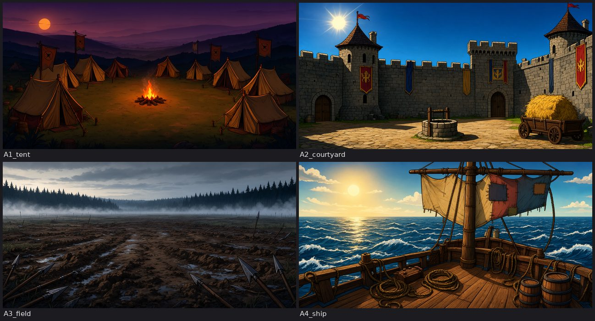

- Made for: Four empty places (dusk tent camp, noon courtyard, muddy field, ship deck), 2048x1024, as backdrops for hero placement and 2.5D cards.
- HF / file path: `hf://datasets/vano1919/tmr-artifacts/route_test_2026-11/assets/A/ (A1_tent, A2_courtyard, A3_field, A4_ship)`
- Route: J5 (backdrop plates); J2/J4 first frames reuse them as places
- Cost: part of the asset pod: about US$1.08 (balance 10.17 -> 9.09, pod 0t2re35vf6f3sq, 40 min at $1.69/h)
- Verdict (good): All four PASS in verdicts.json ('empty backdrop, look held, props as asked'); seen on this sheet: one drawn world, no people, strong readable props. Caveats: the time of day is painted in (A1 dusk, A2 harsh noon), so a place cannot be reused at another hour; they are flat 2:1 plates, no seam-verified 360; a 44-degree crop of a 2048-px-wide 360 is about 250 px wide, so about 10x soft at 2560 (arithmetic from the brief's 44 degrees; the J5 collage therefore crops the plate flat, see j5_step1).
- Sources: route_test_2026-11/assets/verdicts.json, handoffs/HANDOFF_assets_pod.md, handoffs/HANDOFF_STEP1.md, own reading of the sheet
- Not verified: no pixel-diff or keyframe-gate VLM report exists (72B did not fit 48 GB)

## assets_B_hero_sheets — mixed

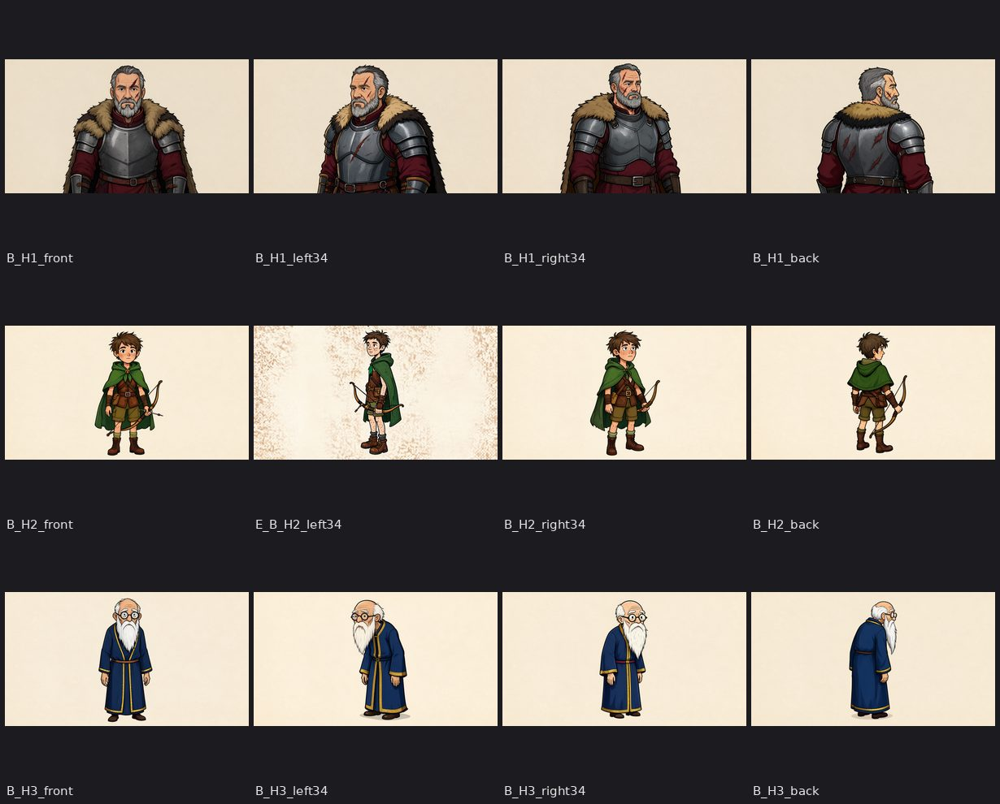

- Made for: Flat-lit turnaround sheets of the three heroes (H1 commander, H2 scout, H3 elder) on a plain background, to be cut out and to serve as identity references.
- HF / file path: `hf://datasets/vano1919/tmr-artifacts/route_test_2026-11/assets/B/ (B_H1/H2/H3 x front, left34, right34, back; the left34 of H2 is assets/E/E_B_H2_left34.png)`
- Route: J5 cut-outs (cards); Qwen reference images for J2/J4 first frames
- Cost: in the asset pod above
- Verdict (mixed): Identity inside a hero holds (CLIP cosine against B_H1_front: own angles .93-.98, other heroes .62-.66, identity.json). Limits seen on the sheet and on record: H1's four sheets end at the belt, so there is no wide shot and no foot shadow; H2 and H3 are full-body but small in a wide canvas, so a cut-out is low resolution; H2's first left-facing sheet showed three figures (rejected) and its replacement has a blotchy paper background; there are no mouth, blink or brow variants for any hero, so any face motion is synthetic.
- Sources: verdicts.json, identity.json, handoffs/HANDOFF_STEP1.md ('H1 has no legs', 'no mouth states')
- Not verified: the cut-out edge quality on the pod failed to run (dtype error), only the CPU cut-outs of J5 step 1 exist

## assets_C_hero_in_backdrop — mixed

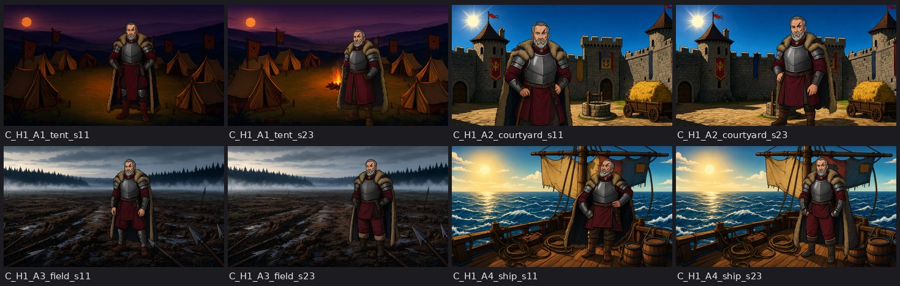

- Made for: Question C: does the hero survive a change of environment when Qwen places him in a backdrop by reference (seeds 11 and 23)?
- HF / file path: `hf://datasets/vano1919/tmr-artifacts/route_test_2026-11/assets/C/ (C_H1_<place>_s11|s23)`
- Route: J2/J4 first frames (hero placed in a place by reference)
- Cost: in the asset pod above
- Verdict (mixed): Answer on record: the environment change did not break the hero (CLIP cosine .78-.82 against the front sheet; the ship at seed 11 is weakest, .70: shorter beard, softer face). Seen on the sheet: face, scar, beard, fur and armour are kept, but pose and boots drift, the pose is a stiff centred stand, scale differs between the two seeds, and in the tent at seed 11 the campfire of the backdrop is gone while seed 23 keeps it (the model may delete backdrop props).
- Sources: verdicts.json, identity.json, handoffs/HANDOFF_assets_pod.md, own reading
- Not verified: why the fire disappears at seed 11 was not investigated

## assets_D_prompt_40_vs_90 — good

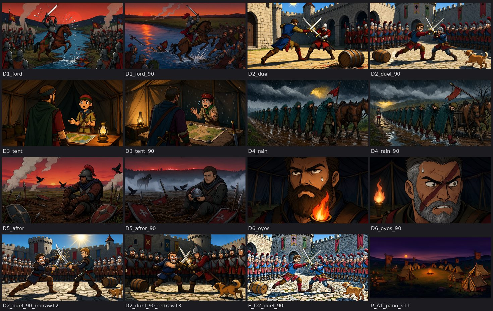

- Made for: Six scenes at about 40 words and again at 90 words (does a longer prompt keep the look and add every named prop?), two redraws of the duel, a rejected edit-fix of the duel crowd and a panorama outpaint test (last tile).
- HF / file path: `hf://datasets/vano1919/tmr-artifacts/route_test_2026-11/assets/D/, D2/ (the _90 variants), P/P_A1_pano_s11.png, rejected/E_D2_duel_90.png`
- Route: J2/J4 first frames (text-to-image look test)
- Cost: in the asset pod above
- Verdict (good): Both lengths hold the xworld look; 90 words add every named prop (the best of the set is D4_rain_90). The known defect is crowds: D2_duel_90 shows the ring of soldiers as a row of near-identical clones, the edit fix did not remove it and the look drifted (rejected), seed 13 varies beards and helmets more. Small misses: D5 helmet worn not held at 40 words; D6_eyes_90 draws the scar as a big red slash. Panorama (nomadoor outpaint LoRA, licence qwen-research): horizon continues, seam scores 1.76/1.66 (a TEST row, not a pass).
- Sources: verdicts.json, handoffs/HANDOFF_assets_pod.md, own reading
- Not verified: no automatic keyframe gate was run; verdicts are a reader's

## step3_qwen_150_words — mixed

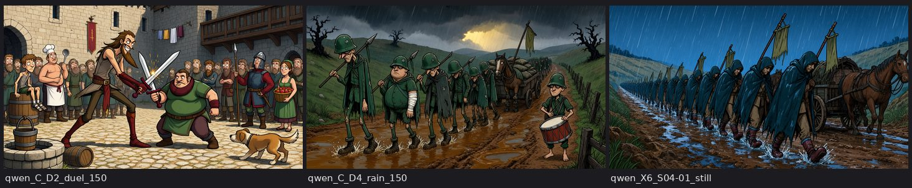

- Made for: Run C: do 150-word prompts keep the style, and do crowd clones vanish? Run X6: one 45-word still of the travel shot (still plus free camera move against an LTX i2v of it).
- HF / file path: `hf://datasets/vano1919/tmr-artifacts/route_test_2026-11/step3/qwen/ (C_D2_duel_150, C_D4_rain_150, X6_S04-01_still), step3/first_frames/S04-01.png`
- Route: J2/J4 first frames; the still of X6 for a STILL_3D camera move
- Cost: step-3 pod ygg2ztmflr8pv2 (balance 9.09 -> 7.99 across it; the pod ledger was not opened here)
- Verdict (mixed): Style and composition held at about 145 words; anatomy defects were not prevented. The creator saw two noses on the front-left soldier of the rain picture (15:07 UTC); Fable saw legs torn to the bone, back-row faces repeating and an odd crossed-sword grip in the duel, and X6 cleaner and more comic-book than our look with the far column as clones. Conclusion on record: a keyframe gate plus a fix-edit is needed.
- Sources: handoffs/VERDICTS_step3_pod1_creator.md
- Not verified: no gate or fix-edit was run on them

## step3_cutouts_BiRefNet — bad

- Made for: Run D: are BiRefNet alpha edges clean enough for 2.5D cards?
- HF / file path: `hf://datasets/vano1919/tmr-artifacts/route_test_2026-11/step3/ (no cutout folder)`
- Route: J5
- Cost: in the step-3 pod above
- Verdict (bad): Failed on the pod (dtype error); the question is answered only indirectly by the J5 collage, whose CPU cut-outs look clean at 2560x1440 (see j5_step1).
- Sources: step3_pod1/cutout_report.json, stages.txt ('D failed')
- Not verified: no edge-quality number exists
- Why no image: the pod run failed before writing any cut-out (cutout_report.json: 'Input type (float) and bias type (c10::Half) should be the same' on all rows); the dtype fix is on icw/16-lean-pod and the working cut-outs came later on the CPU in J5 step 1 (they are not on HF, only the graded cards are)

## step3_layout_passes — mixed

- Made for: Run A: the clay/colour/depth/line passes that drive LTX Layout-To-Render and restyle.
- HF / file path: `hf://datasets/vano1919/tmr-artifacts/route_test_2026-11/layouts/`
- Route: J2/J4 control passes
- Cost: free (Blender on the pod CPU)
- Verdict (mixed): A.duel ran ok and A.frame0 failed in the pod log; A.battle has no result line; only one duel line frame is on HF. The stills of the battle layout that do exist are in pilot_p1_contact_11.
- Sources: step3_pod1/stages.txt
- Not verified: whether the battle passes ever finished
- Why no image: HF holds only route_test_2026-11/layouts/duel/line/frame0_000000.png (146 KB); it was not available as a file in this session, so no picture is on the branch

## pilot_room_blender_stills — mixed

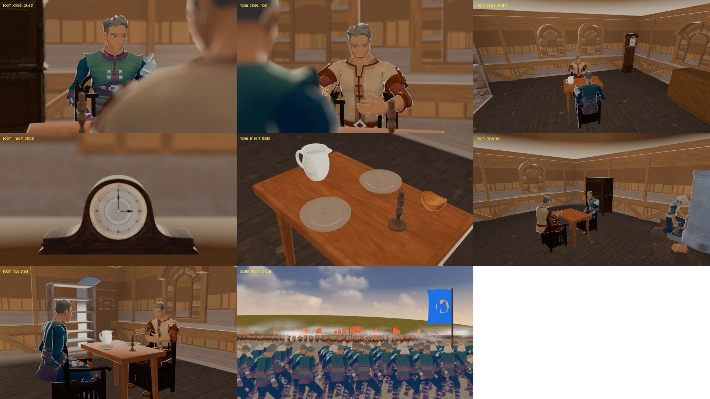

- Made for: Seven stills of a furnished room, each the first frame of one planned clip with an in_shot list (standing order 14); Qwen redraws the look, so these are inputs, not final pictures.
- HF / file path: `hf://datasets/vano1919/tmr-artifacts/route_test_2026-11/pilot/blender/ (room_*.png at 2560x1440, pilot_stills.json)`
- Route: stage 1 of the pilot: Blender still -> Qwen restyle -> LTX i2v (J2/J4 family)
- Cost: US$0 (Blender 5.2.3, EEVEE on the CPU, 50-66 s per still)
- Verdict (mixed): The first round showed the whole set in every camera because the brief did not list what the clip needs; the in_shot round (this sheet) fixes that. Known flaws on record: the bookshelf reads pale and the candle flame is not visible; the Blender cast are stand-ins (the guest wears a ranger costume) that only fix pose and place; Qwen draws the heroes from their sheets. The Blender look itself is never the final picture (the plan's principle 6).
- Sources: plans/PILOT_1MIN_PLAN_v3.md, plans/FINAL_HIGH_LEVEL_PLAN_ka.md, own reading
- Not verified: the Qwen restyle of these stills has not been seen: the p15 pod has not placed (OPEN_QUESTIONS)

## pilot_battle_blender_stills — mixed

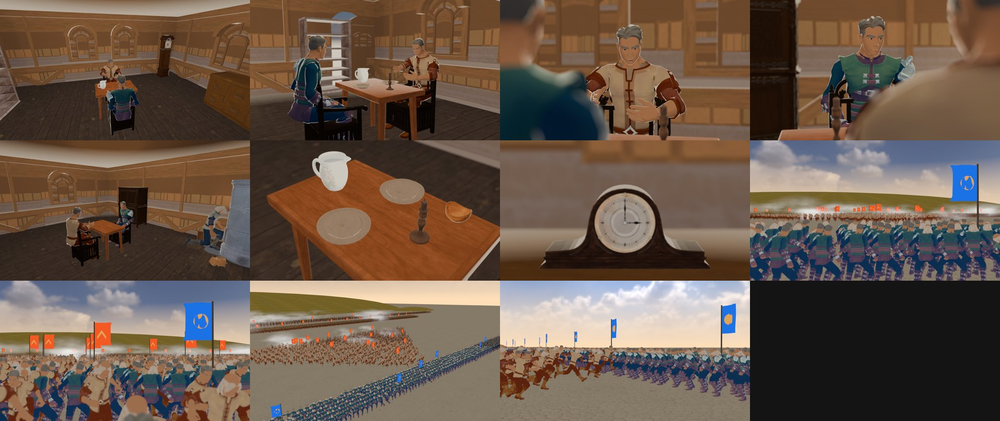

- Made for: The 11-still contact sheet of the pilot minute: seven room stills plus battle frame 0, frame 200, wide high and front mid.
- HF / file path: `hf://datasets/vano1919/tmr-artifacts/route_test_2026-11/pilot/blender/ (battle_f000/f200 colour+depth, battle_wide_high_f112_colour, battle_front_mid_f112_colour, pilot_stills_p16.json)`
- Route: J4 family (crowd), stage 1 of the pilot and P1
- Cost: US$0 (5,000 Quaternius soldiers; colour 202.3 s/frame, depth 238.1 s/frame)
- Verdict (mixed): Good as layout and crowd composition (thousands of agents, banners, two armies), weak as a picture. Battle frame 0 is from behind the front rank, so it shows no faces and no commander; wide high and front mid are taken at frame 112, just before contact, and the baked crowd has no real collision (the wedge passes through the wall after about frame 130), so LTX would have to invent the clash. The soldiers repeat one template.
- Sources: handoffs/HANDOFF_P1.md, plans/PILOT_1MIN_PLAN_v3.md, own reading
- Not verified: no LTX clip of any of these exists

## j5_step1_collage — mixed

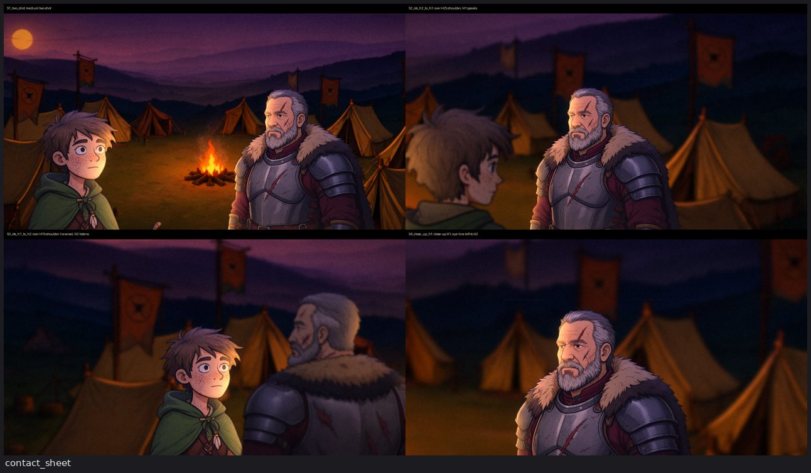

- Made for: One dialogue (H2 scout, H1 commander, backdrop A1) cut as J5 would: two-shot, over-the-shoulder each way, close-up of H1.
- HF / file path: `hf://datasets/vano1919/tmr-artifacts/route_test_2026-11/j5_dialogue/step1/ (S1..S4, contact_sheet.png, cards/, compare/, report.json)`
- Route: J5 (Qwen sheets cut out as cards, Blender 2.5D, no LTX)
- Cost: US$0 (95 s for four 2560x1440 frames on 4 cores; cut-out about 20 s per sheet)
- Verdict (mixed): Good: identity and the world are exactly the approved sheet and plate, the cut is free and fast, the 180-degree rule and eye-lines hold. Bad (the creator's own reading, 2026-11-06): the man in the picture is not good enough because too few reference frames were supplied; seen here: H1 exists only as a belt-up card from two sheets (left34, back), the reverse shot uses the back sheet mirrored, the close-up is the same card enlarged and soft, and no mouth or blink variants exist. Backgrounds in the over-the-shoulder shots are heavily blurred plate crops.
- Sources: handoffs/HANDOFF_STEP1.md, the creator's words relayed in the Argon brief, report.json (plate crops), own reading
- Not verified: the creator's exact message is not re-read here

## j5_step2_stills_v2_and_motion — mixed

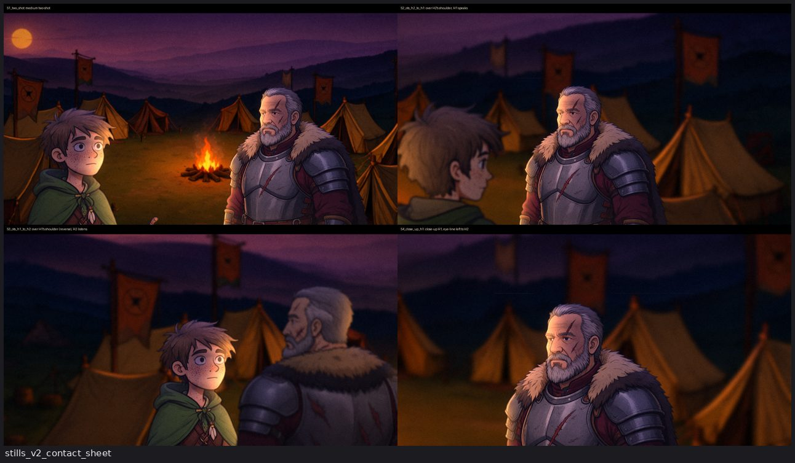

- Made for: Step 2: face shadow on the cards and an animated background (parallax drift, fire flicker, smoke) with no voice and no mouth yet.
- HF / file path: `hf://datasets/vano1919/tmr-artifacts/route_test_2026-11/j5_dialogue/step2/ (stills_v2/, video_contact.png; the preview mp4 is in project files)`
- Route: J5
- Cost: US$0 (background motion about 1.3 s per frame at 2560x1440 on 4 cores)
- Verdict (mixed): Cheap motion works: the plate is a flat card 40 m away so a camera drift gives parallax for free. No mouth or eye variants exist, so there is no mouth motion yet; the handoff names this as the thing the step lacks.
- Sources: handoffs/HANDOFF_STEP1.md (step 2 update), docs/J5_DIALOGUE_COLLAGE.md
- Not verified: the creator's verdict on the step-2 clip is not on record in the files read

## j5_step3_idle_and_dissolve — mixed

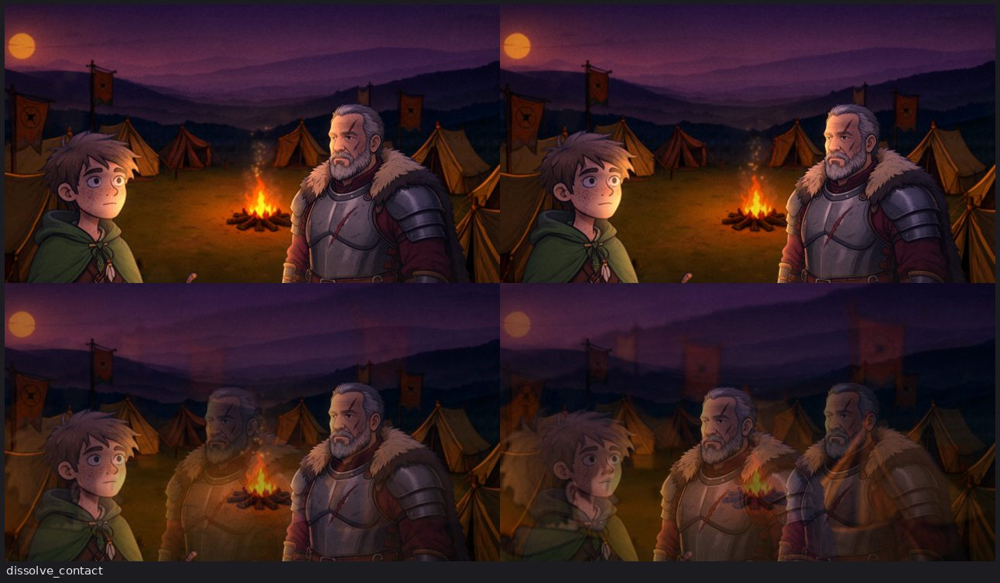

- Made for: Step 3: idle motion of both figures (sway, head turn, nod, breath, cloth), ease-in-out camera, 0.42 s dissolve or a dip to black between shots.
- HF / file path: `hf://datasets/vano1919/tmr-artifacts/route_test_2026-11/j5_dialogue/step3/ (dissolve_contact.png; dip and dissolve mp4s in project files)`
- Route: J5
- Cost: US$0
- Verdict (mixed): Dip to black was chosen over the dissolve; the next version should dip slower (about 0.7 s). Idle motion is synthetic card motion with no new drawings, so it reads as a paper doll when watched long (the risk the plan names).
- Sources: handoffs/HANDOFF_STEP3.md, memory note in PLANS
- Not verified: paper-doll judgement is the plan's stated risk, not a measured result

## j5_step4_voice_and_mouth — mixed

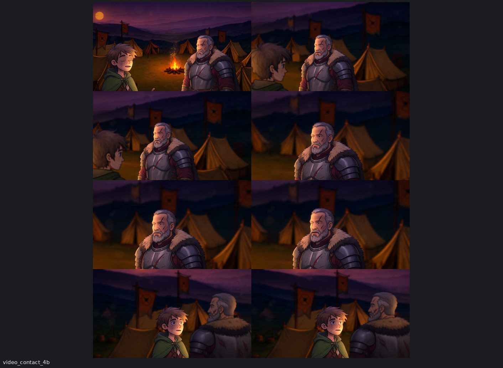

- Made for: Step 4 and 4b: three voiced lines in two voices, Rhubarb Lip Sync mouth cues drawn on the cards, blinks, brows, jaw; 4b (commit f7add32): jaw moves only the chin zone, shaded mouth interior with teeth, head bob, harder camera push.
- HF / file path: `hf://datasets/vano1919/tmr-artifacts/route_test_2026-11/j5_dialogue/step4/ (video_contact.png, video_contact_4b.png, voice/, full crf14 clip)`
- Route: J5 with ElevenLabs voice
- Cost: 155 ElevenLabs credits (three lines, one take each, cap 5000); no GPU
- Verdict (mixed): Mouth, blink and brow are drawn procedurally on the graded cards with no model, so they are free; but real drawn mouth and eye variants per sheet still do not exist (a paid Qwen edit, the creator's call), the commander is belt-up only and the scout has no left-facing card. The creator's verdict on 4 or 4b is not on record in the files read.
- Sources: handoffs/HANDOFF_STEP4.md, docs/J5_DIALOGUE_COLLAGE.md section 7c, commit message of f7add32
- Not verified: listening test of the voices (EL-01) not done; 4b contact sheet seen, the clip itself not watched

## upscale_chain_check — good

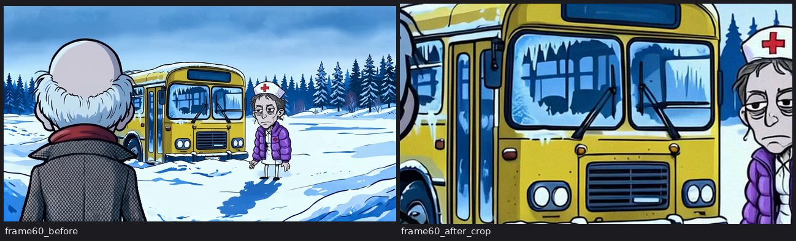

- Made for: Does crop 16:9, lanczos to 2560x1440, cas 0.4, temporal noise keep the ink and the palette of an LTX 1280x704 clip?
- HF / file path: `project files route_test_2026-11/upscale_check/ (clip_S01-04.mp4, clip_S01-04_up.mp4, compare.json)`
- Route: J2/J4 finishing (free FFmpeg upscale)
- Cost: US$0
- Verdict (good): compare.json: ink ratio 1.009-1.019, palette distance under 0.002, sharpness ratio 1.01 at frames 0, 60 and 120: the chain neither thickens nor loses ink. The gain is at the 1440p pixel scale, which the downscaled comparison cannot show and was judged by eye. The clip is from the older film A, not from the Ink Chronicle look.
- Sources: compare.json
- Not verified: not re-run on Ink Chronicle clips

## old_film_A — mixed

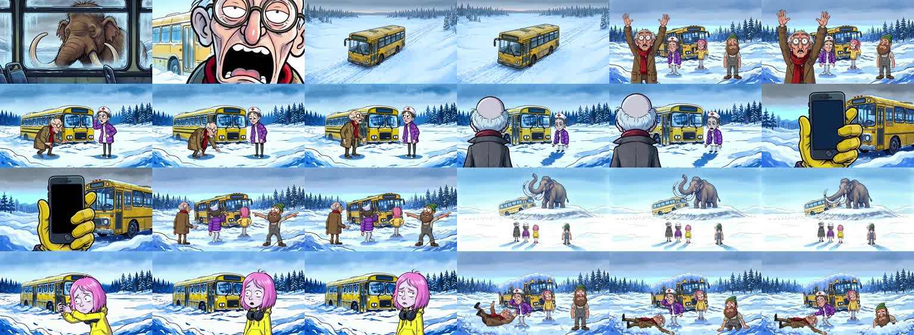

- Made for: The one-minute film of the earlier era (a bus stuck in snow, a mammoth): the cost baseline of the LTX route.
- HF / file path: `project files film_1min_2026-10-25/film/ (film_A_ltx_voices.mp4, film_A_sheet.jpg); the sheet is 24 frames of the film`
- Route: old route (Qwen keyframes + LTX-2.5 i2v clips, one pod)
- Cost: US$2.99 RunPod (film_ledger.json: spent runpod_usd 2.99, cap 4.0); the brief gives 52.6 s of film for it
- Verdict (mixed): Useful as the only measured full-LTX baseline (about $2.99 for about 53 s, so about $0.057 per second of finished film including keyframes) and the characters stay recognisable across shots (nurse, driver, the pink-haired girl, the old man), but it is a different world and look, not Ink Chronicle, and its LTX clips were 1280x704.
- Sources: film_ledger.json, upscale compare.json, the Argon brief (52.6 s)
- Not verified: the 52.6 s length and the per-second figure are not re-measured; the creator's verdict on the film is not re-read

## p12_clay_layout — good

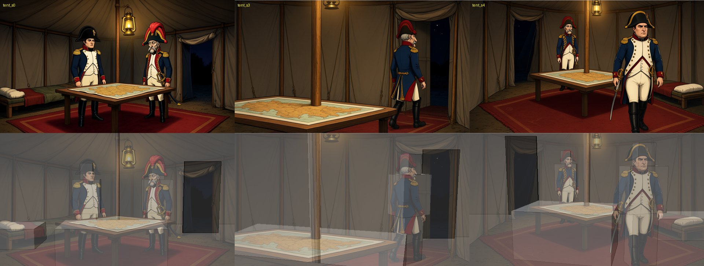

- Made for: Grey clay layouts that drive LTX-2.5 Layout-To-Render; the clay's first frame must match the keyframe.
- HF / file path: `hf://datasets/vano1919/tmr-artifacts/code/p12/clay/ (three clay clips, 1920x1088, 121 frames); preview mp4s in project files p12_clay_2026-11-01/`
- Route: J2 (clay layout for Layout-To-Render)
- Cost: US$0 (pure software painter's algorithm)
- Verdict (good): Top row keyframes, bottom row the clay over them: the boxes sit on the figures, table, tent door and pole closely, which is what the layout pass needs. Not proven: whether LTX follows it (the clay was built for the P12 pod, whose LTX result is not read here). Identity of the two figures in the keyframes is cartoonish Napoleon-era, not Ink Chronicle.
- Sources: docs/PROGRESS.md 2026-11-01 WP-1c/WP-1e, own reading
- Not verified: the P12 LTX result

## ink_round_blender_looks — bad

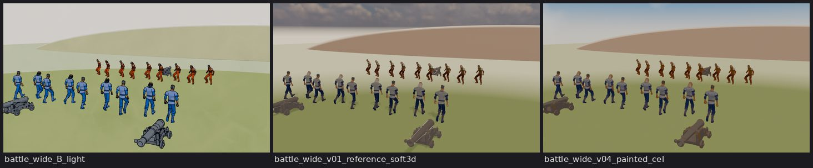

- Made for: ICW-05c: ten look settings from the creator's reference to a flat painting; three of them here on one battle layout.
- HF / file path: `project files ink_chronicle_ink_round_2026-11-05/ (collage_preview.jpg, hero_crops.jpg, frames/, REPORT.md)`
- Route: old Blender-final route (superseded by D-116 roles)
- Cost: US$0 (GitHub Actions, 49 min)
- Verdict (bad): As a final picture: the Blender NPR render failed three times (ICW-05b, ICW-05c, the night run) and the plan therefore forbids it as final pixels. The frames on this sheet show rubber figures on a flat plain with no depth and no ink line. It remains useful as layout input and as the timing table of the look round (REPORT.md).
- Sources: plans/FINAL_HIGH_LEVEL_PLAN_ka.md principle 6 and F-37, handoffs on ink round, own reading
- Not verified: the creator's own pick of looks 3, 2, 4 is the thread's opinion in REPORT.md, not his

## mac_battle30_crowd — mixed

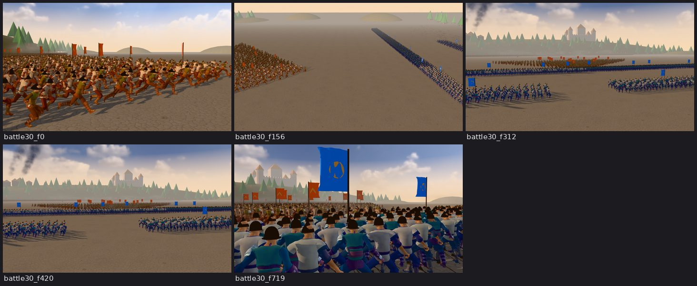

- Made for: A 30-second battle of thousands of agents (frames 0, 156, 312, 420, 719).
- HF / file path: `project files ink_chronicle_overnight_2026-11-05/battle30/ (the two 1080p mp4 parts and five jpg frames)`
- Route: J4 family (crowd source)
- Cost: US$0 (Mac, about 0.76 s per frame per the plan's F-35)
- Verdict (mixed): Good as a structure for J4 (agents, banners, formations, long camera paths at about 0.76 s per frame, 5-15x cheaper than LTX). Bad as a picture: flat sky, repeated figures, the look the plan calls 'a 90s game'.
- Sources: plans/FINAL_HIGH_LEVEL_PLAN_ka.md F-35, F-37, own reading
- Not verified: 0.76 s per frame is the plan's figure, not re-measured

## mac_matrix_E_scenes — bad

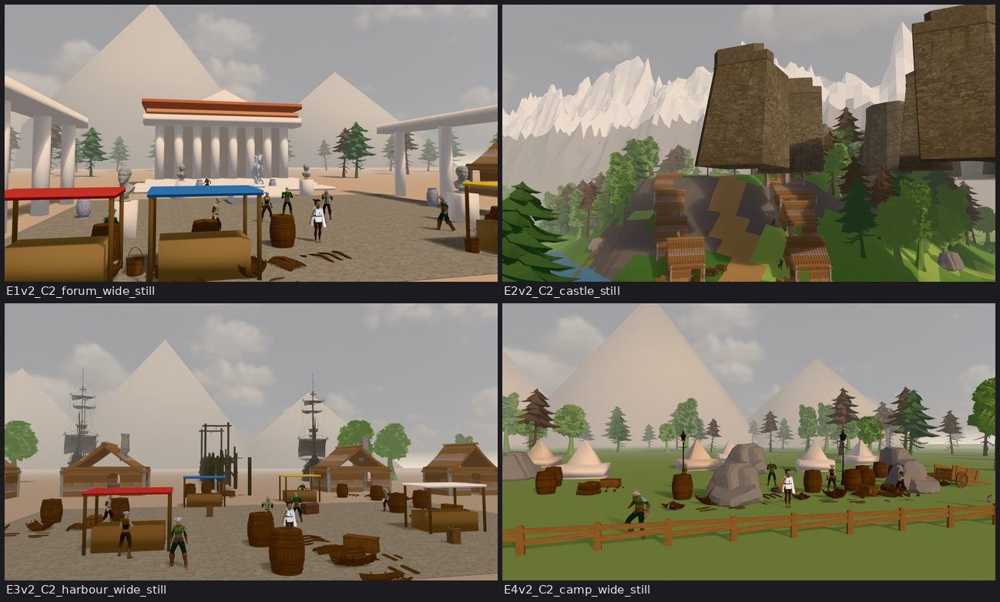

- Made for: Four environments of the overnight matrix (forum, castle, harbour, camp), 2560x1440 EEVEE.
- HF / file path: `project files (E1v2..E4v2 stills in the folder root; matrix/ in ink_chronicle_overnight_2026-11-05/)`
- Route: old Blender-final route
- Cost: US$0 (Apple M4 Pro, 1.1-1.5 s per frame after the first, 5.2 s for the first castle still; E_batch_render_log.json)
- Verdict (bad): Cheap and fast, but the look is the low-poly 90s-game look (F-37) and the castle frame is a broken composition (floating giant wall blocks). Not usable as a final picture; useful only as set geometry.
- Sources: plans/FINAL_HIGH_LEVEL_PLAN_ka.md F-37, project files E_batch_render_log.json, own reading
- Not verified: a placeholder texture was used for the jeans (render log)

## Not on the branch

- Clips (`.mp4`): J5 step 2/3/4 previews, battle30 parts, upscale-check clips, film A: in project files, see each row. Full crf14 J5 clips are on HF under `route_test_2026-11/j5_dialogue/`.
- The ElevenLabs takes of J5 step 4 (`.mp3`/`.wav`) and the old `partA_odom.mp3` pilot audio: not allowed in the repository; in project files `j5_dialogue_step4/voice/` and `route_test_2026-11/pilot_audio/`.
- The route-test script (old vs new, 23-24 shots, LTX clips 18 -> 9): text only, see `handoffs/HANDOFF_route_script.md` and `handoffs/route_script_stats.json`.
- Nothing from the p15 pod (Qwen restyle of the pilot stills, LTX clips) exists yet: the pod has not placed (see OPEN_QUESTIONS).
